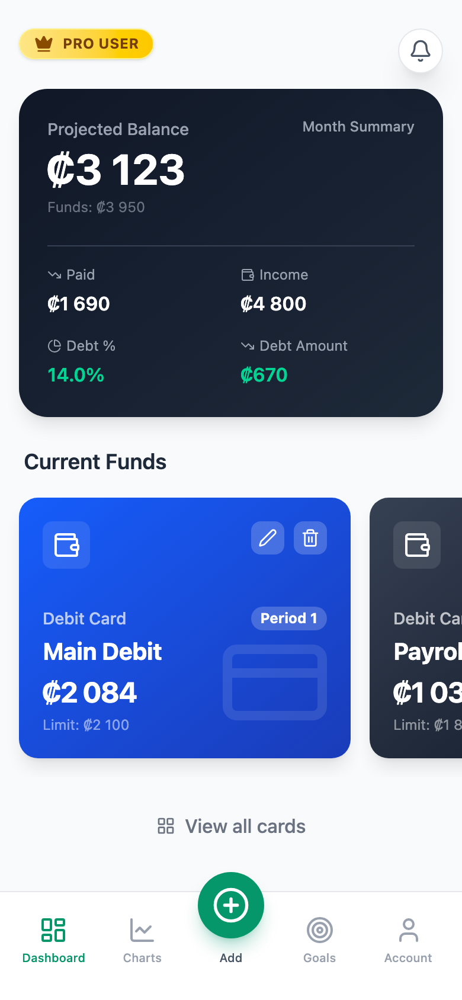
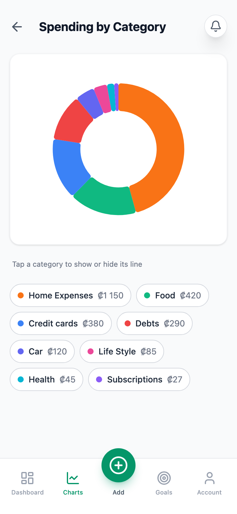
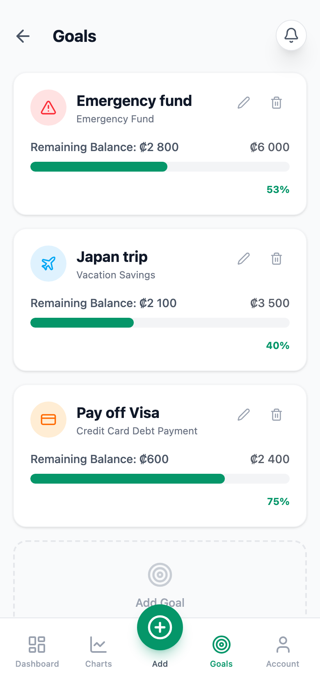
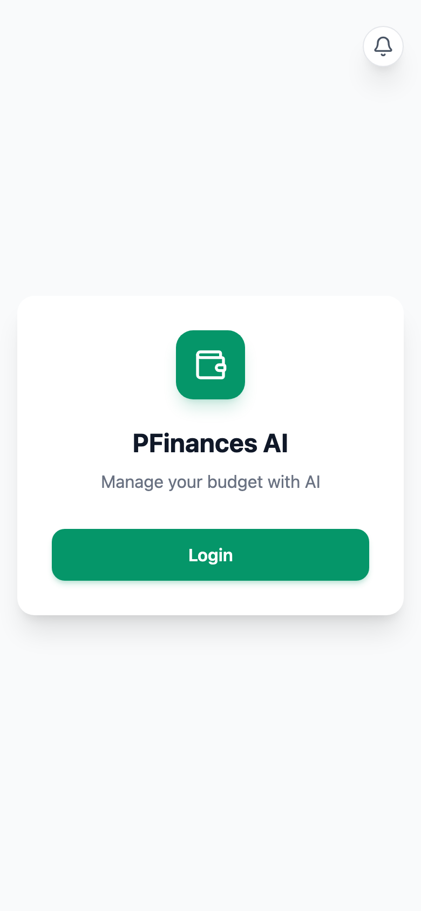
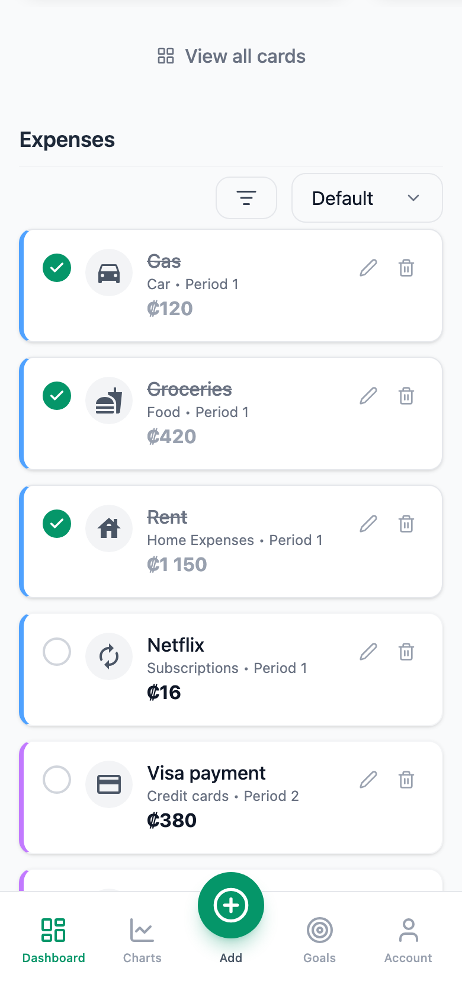
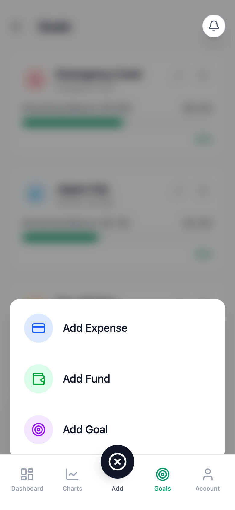
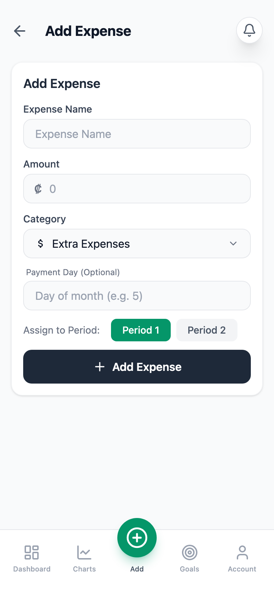
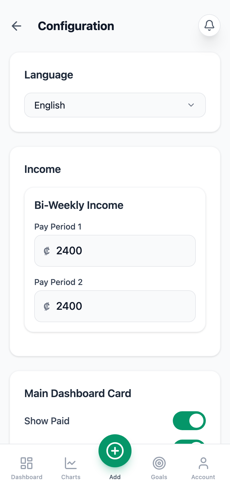
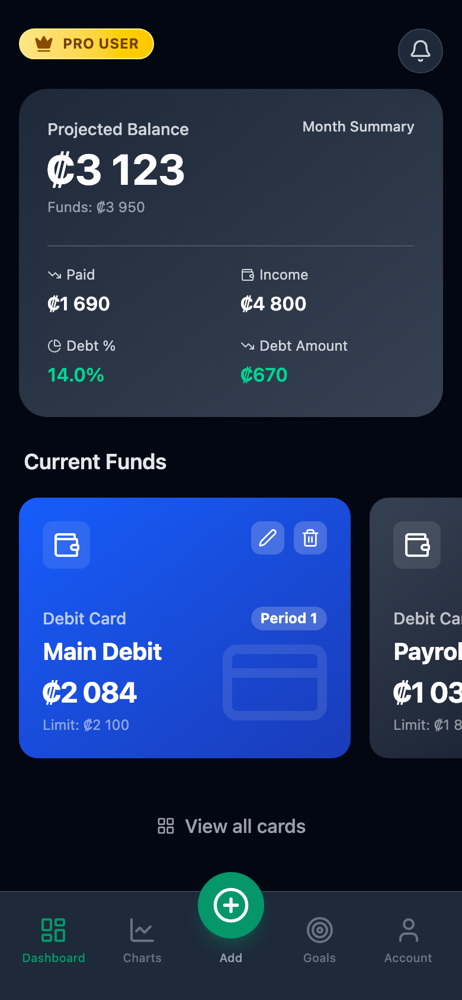
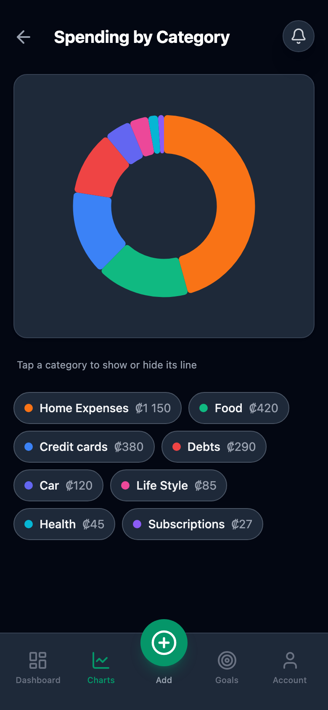

<div align="center">


# PFinances AI

**Smart finance, simplified by AI.**
A mobile‑first, installable budget app built around the way you actually get paid: twice a month.


<br/>


&nbsp;

&nbsp;


</div>

---

## ✨ Features

| | |
|---|---|
| 💰 **Projected balance** | See what's really left after unpaid bills, plus paid, income, debt % and debt amount at a glance. |
| 📆 **Two pay periods** | Assign every expense and fund to *Period 1* or *Period 2* — built for bi‑weekly paychecks. |
| 💳 **Funds as cards** | Debit, credit, cash, savings, investment or loan — each with its own color and per‑period available balance. |
| ✅ **Expense checklist** | Tick bills off as you pay them, drag to reorder, filter and sort by category. |
| 🍩 **Spending charts** | Donut breakdown by category with tap‑to‑toggle legend chips. |
| 🎯 **Goals** | Track emergency funds, trips or debt payoff with progress bars. |
| 🌗 **Light & dark** | Follows your system theme automatically. |
| 🌎 **English / Español** | Full i18n, switchable from Configuration. |
| 📲 **Installable PWA** | Works offline, installs to your home screen, prompts when a new version ships. |
| 📤 **CSV import / export** | Your data lives in your browser — back it up or move it anytime. |

## 📸 Screenshots

<table>
  <tr>
    <td align="center"><br/><sub><b>Welcome</b></sub></td>
    <td align="center"><br/><sub><b>Dashboard</b></sub></td>
    <td align="center"><br/><sub><b>Expenses</b></sub></td>
    <td align="center"><br/><sub><b>Charts</b></sub></td>
  </tr>
  <tr>
    <td align="center"><br/><sub><b>Goals</b></sub></td>
    <td align="center"><br/><sub><b>Quick add</b></sub></td>
    <td align="center"><br/><sub><b>New expense</b></sub></td>
    <td align="center"><br/><sub><b>Configuration</b></sub></td>
  </tr>
</table>

### 🌙 Dark mode

<p align="center">
  
  &nbsp;
  
</p>

## 🚀 Quick start

```bash
git clone https://github.com/fufales/finance-agent-ai-frontend.git
cd finance-agent-ai-frontend/app
npm install
npm run dev
```

Then open **http://localhost:5173/finances-app/** (the app is served under the `/finances-app/` base path).

| Script | What it does |
|---|---|
| `npm run dev` | Start the Vite dev server with hot reload |
| `npm run build` | Production build + PWA service worker into `app/dist` |
| `npm run preview` | Serve the production build locally |
| `npm run lint` | Run ESLint (also runs on staged files via Husky) |

## 🗂️ Project structure

```
.
├── app/                    # React + Vite PWA (the product)
│   ├── src/
│   │   ├── modules/        # Dashboard, Charts, Goals, Configuration, Login, AllFunds
│   │   ├── components/     # FundCard, Dropdown, Switch, Notifications, Modals
│   │   ├── hooks/          # useFinanceData — state + totals, persisted to localStorage
│   │   ├── context/        # Language (en/es) and Notification providers
│   │   ├── locales/        # en.json · es.json
│   │   └── utils/          # categories, currency formatting, CSV import/export
│   └── public/             # icons, manifest, sounds
├── backend/                # Laravel API (scaffold — auth & sync coming soon)
└── .github/workflows/      # CI: build and deploy on push to main
```

## 🧠 How it works

- **Local‑first.** All data is stored in the browser under `pfinances_data_v1`; nothing leaves the device yet.
- **Balances.** *Projected balance* = funds that affect balance − unpaid expenses. Each fund card shows what's available for its assigned period.
- **Debt ratio.** Expenses in *Debts* and *Credit cards* are summed and divided by total income.
- **Deploy.** Every push to `main` builds the app and rsyncs `app/dist` to the server through a Cloudflare tunnel.

## 🛣️ Roadmap

- [ ] Real authentication with the Laravel backend
- [ ] Cloud sync across devices
- [ ] AI insights: spending tips and bill forecasting
- [ ] Monthly history and trends

---

<div align="center">
<sub>Made with 💚 by <a href="https://github.com/fufales">@fufales</a></sub>
</div>
